  

  

  
  
  

## Focus

AI駆動開発とネットワーク・サーバ構築が趣味です。
このアカウントは検証・習作を含むコードの保管庫です。経歴・資格・構築事例などの整理されたアウトプットは [ポートフォリオサイト](https://www.termnix-it.jp) にまとめています。

公開リポジトリの中身は、Claude Code / Codex を育てるハーネスと MCP サーバー、Rust で作る Windows 向けデスクトップツール、React と Three.js の Web アプリ、ローカル LLM を使った Discord Bot、自宅 Ubuntu サーバーの基盤、Godot 4 のゲーム、Terraform で検証する AWS 構成が中心です。

  
  
  
  
  
  
  

  

## 主に扱う技術

| 分類 | 技術 |
| --- | --- |
| 言語 |  |
| アプリ・Web |  |
| インフラ・運用 |  |

## いま作っているもの

| テーマ | 代表リポジトリ | 内容 |
| --- | --- | --- |
| AI エージェント | [Codex-Harness](https://github.com/Termnix-IT/Codex-Harness) [DevEnvironmentInspector](https://github.com/Termnix-IT/DevEnvironmentInspector) | エージェントへの指示ファイルを育てるハーネスと、開発環境を調べる MCP サーバー |
| 自宅インフラ | [MyInfraServiceBox](https://github.com/Termnix-IT/MyInfraServiceBox) | 自宅の Ubuntu サーバーで宅内向け Web サービスを動かすポータル・共有 PostgreSQL・デプロイ CLI |
| デスクトップツール | [PortManagerTool](https://github.com/Termnix-IT/PortManagerTool) [oterm](https://github.com/Termnix-IT/oterm) | Rust / Electron で作る Windows 向けのポート管理ツールと自作ターミナル |
| Web・3D | [PoseRef](https://github.com/Termnix-IT/PoseRef) [pirafu-playground](https://github.com/Termnix-IT/pirafu-playground) | 画像生成 AI 向けのポーズ参考画像ツールと、自作 Web アプリ・ミニゲームの置き場 |
| ゲーム | [DungeonRemnant](https://github.com/Termnix-IT/DungeonRemnant) | Godot 製の見下ろし型アクションローグライト（開発中） |

## Arcade

ブラウザでそのまま遊べる・使える作品です。ほかの作品は [Pirafu2411 Playground](https://pirafu2411.pages.dev) にまとめています。

<table>
  <tr>
    <td align="center" width="33%">
      
       <b>DOPASWEEPER</b>
       60 秒でどこまで開けるかを競う、演出過剰なマインスイーパー
       
    </td>
    <td align="center" width="33%">
      
       <b>PoseRef</b>
       マネキンにポーズを付けて、画像生成 AI 用の参考画像を書き出す
       
    </td>
    <td align="center" width="33%">
      
       <b>Pirafu2411 Playground</b>
       自作のミニゲーム・Web アプリ・ツールの一覧
       
    </td>
  </tr>
</table>

## リポジトリ統計

  
  
  

  ※ 言語比率は公開リポジトリの実測値です。業務・学習での比重は <a href="https://www.termnix-it.jp">ポートフォリオサイト</a> を参照ください。

## Activity

  <picture>
    <source media="(prefers-color-scheme: dark)" srcset="https://raw.githubusercontent.com/Termnix-IT/Termnix-IT/output/github-snake-dark.svg" />
    <source media="(prefers-color-scheme: light)" srcset="https://raw.githubusercontent.com/Termnix-IT/Termnix-IT/output/github-snake.svg" />
    
  </picture>

---

  Built around Linux, networking, tool-making, and public learning.

  

